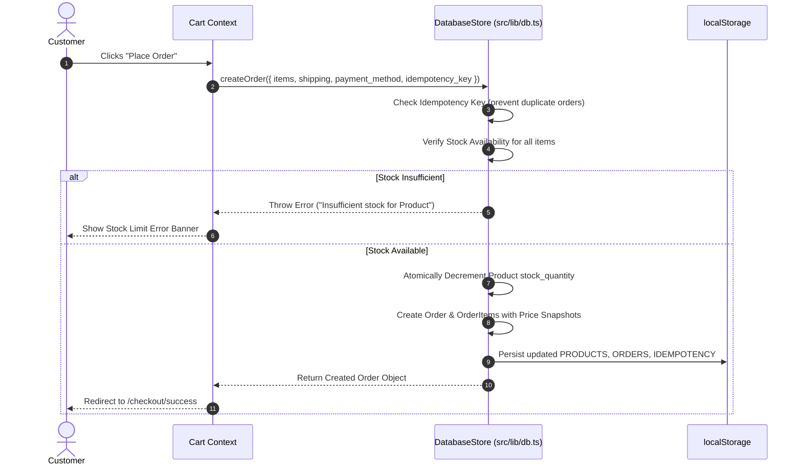

# Hastkala — Technical Architecture & Developer Handbook

Detailed documentation is also available in `docs/TECHNICAL_DOCUMENTATION.md`.

This document provides a comprehensive technical breakdown of the **Hastkala** codebase, database schema, server endpoints, AI integrations, security controls, developer setup instructions, and deployment routines.

---

## Table of Contents
1. [Tech Stack & System Architecture](#1-tech-stack--system-architecture)
2. [Server Endpoints & AI Integrations](#2-server-endpoints--ai-integrations)
3. [Database Schema & Data Models](#3-database-schema--data-models)
4. [Sequence Diagrams & Data Flows](#4-sequence-diagrams--data-flows)
5. [Developer Setup & Maintenance](#5-developer-setup--maintenance)
6. [Security, Privacy, & Governance](#6-security-privacy--governance)

---

## 1. Tech Stack & System Architecture

### Frontend Layer
- **Framework**: React 19 (SPA mode) with Vite build tools.
- **Language**: TypeScript 5.7+ (Strict mode enabled).
- **Styling**: Tailwind CSS v4 (`@import "tailwindcss";` in `src/index.css`), custom brand palette.
- **Icons & Motion**: Lucide React icons (`lucide-react`), Framer Motion / Motion.
- **State Management**: React Context APIs (`AuthProvider`, `CartProvider`, `WishlistProvider`).
- **Routing**: Lightweight custom hash/path router (`src/lib/router.tsx`) supporting pushState navigation and route parameter extraction.

### Backend & API Layer
- **Runtime**: Node.js (v18+ or v20+) running Express (`server.ts`).
- **Dev Server**: `tsx server.ts` with Vite middlewares mounted in non-production mode (`vite.middlewares`).
- **AI SDK**: `@google/genai` (v2.4.0) configured with Gemini 2.5 Flash model (`gemini-2.5-flash`).

### Data Persistence Layer
- **Client/Hydration Store**: `src/lib/db.ts` (`DatabaseStore`), an in-memory runtime store with automatic `localStorage` persistence and fallback seed data (`src/lib/seed-data.ts`).
- **PostgreSQL / Supabase Database**: Complete production migration script in `supabase/migrations/20261021000000_create_craft_here_schema.sql` featuring tables, indexes, foreign keys, triggers, and Row-Level Security (RLS) policies.

---

## 2. Server Endpoints & AI Integrations

All API endpoints are defined in `server.ts` and run on port 3000:

### 1. Multilingual Voice-First AI Cataloguer
- **Endpoint**: `POST /api/ai/cataloguer`
- **Purpose**: Converts spoken/typed artisan notes into structured, e-commerce listings with English and Hindi descriptions.
- **Request Body**:
  ```json
  {
    "textInput": "Spoken or typed notes",
    "language": "hi | kn | te | ta | en | bn | mr | gu",
    "artisanLocation": "Udayagiri, Andhra Pradesh",
    "craftType": "Udayagiri Wooden Cutlery"
  }
  ```

### 2. AI Product Photography Enhancement
- **Endpoint**: `POST /api/ai/enhance-image`
- **Purpose**: Optimizes white balance, lighting contrast, and framing for product photos.

### 3. Fair & Transparent Pricing Calculator
- **Endpoint**: `POST /api/ai/pricing-calc`
- **Purpose**: Calculates mathematical production costs and suggested retail prices.

### 4. Polish Artisan Notes
- **Endpoint**: `POST /api/ai/describe`

### 5. Multilingual Text Translation
- **Endpoint**: `POST /api/ai/translate`

### 6. Health Check
- **Endpoint**: `GET /api/health`

---

## 3. Database Schema & Data Models

### Principal Entities

```
+-------------------+       +--------------------+       +----------------------+
|     Profile       |       |   ArtisanProfile   |       |       Product        |
+-------------------+       +--------------------+       +----------------------+
| id (PK)           |<----->| id (PK)            |<----->| id (PK)              |
| email             | 1   1 | user_id (FK)       | 1   N | artisan_id (FK)      |
| full_name         |       | business_name      |       | category_id (FK)     |
| role              |       | craft_specialty    |       | title, slug          |
| created_at        |       | region, city       |       | price, stock_quantity|
+-------------------+       | verification_status|       | status, images       |
                            +--------------------+       +----------------------+
                                                                    ^
                                                                    |
                                                            +-------+--------------+
                                                            |      OrderItem       |
                                                            +----------------------+
                                                            | id (PK)              |
                                                            | order_id (FK)        |
                                                            | product_id (FK)      |
                                                            | unit_price_snapshot  |
                                                            | quantity             |
                                                            +----------------------+
```

1. **`Profile`**: Platform users (`customer`, `artisan`, `admin`).
2. **`ArtisanProfile`**: Extended maker profile.
3. **`Product`**: Handmade items.
4. **`Category`**: Craft disciplines.
5. **`CraftStory`**: Editorial living heritage articles.
6. **`Order` & `OrderItem`**: Transactions with price snapshots and atomic stock decrements.
7. **`BulkEnquiry`**: Wholesale B2B enquiry records.
8. **`ProvenanceEvidence`**: Verification documents.

---

## 4. Sequence Diagrams & Data Flows

### Customer Checkout & Inventory Transaction


---

## 5. Developer Setup & Maintenance

### Installation
```bash
git clone <repository-url>
cd hastkala
npm install
```

### Commands
```bash
npm run dev     # Starts Express + Vite on http://localhost:3000
npm test        # Runs unit tests
npm run lint    # Typechecks codebase
npm run build   # Production build
```

---

*Hastkala Technical Documentation v1.0 — Architecture, APIs, and Database Specification.*
