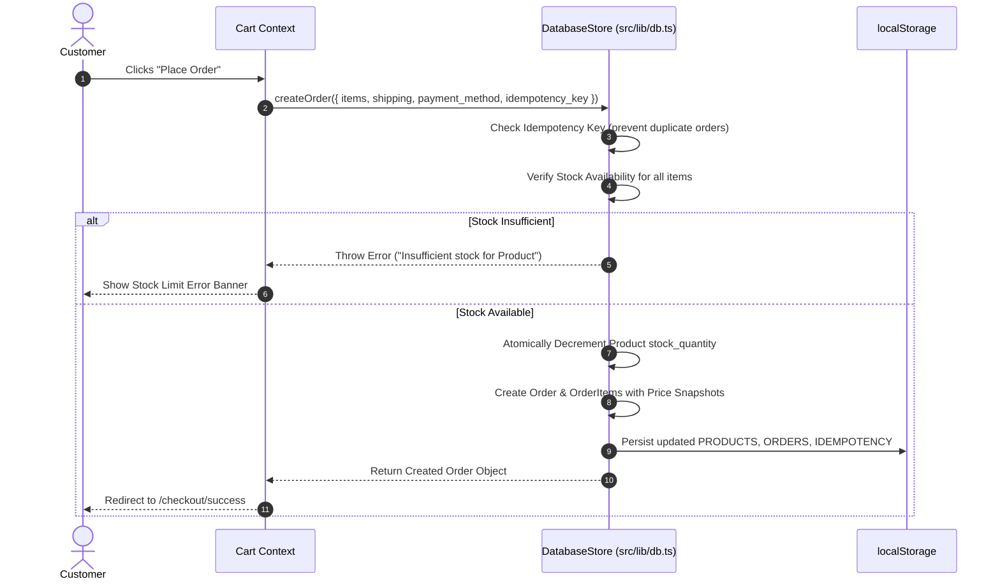
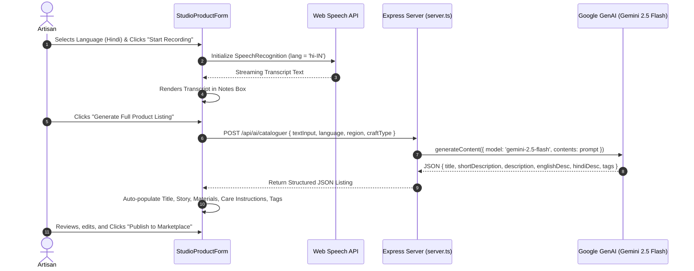

# Hastkala — Technical Architecture & Developer Handbook

This document provides a comprehensive technical breakdown of the **Hastkala** codebase, database schema, server endpoints, AI integrations, security controls, developer setup instructions, and deployment routines.

---

## Table of Contents
1. [Tech Stack & System Architecture](#1-tech-stack--system-architecture)
2. [Server Endpoints & AI Integrations](#2-server-endpoints--ai-integrations)
3. [Database Schema & Data Models](#3-database-schema--data-models)
4. [Sequence Diagrams & Data Flows](#4-sequence-diagrams--data-flows)
5. [Developer Setup & Maintenance](#5-developer-setup--maintenance)
6. [Security, Privacy, & Governance](#6-security-privacy--governance)

---

## 1. Tech Stack & System Architecture

### Frontend Layer
- **Framework**: React 19 (SPA mode) with Vite build tools.
- **Language**: TypeScript 5.7+ (Strict mode enabled).
- **Styling**: Tailwind CSS v4 (`@import "tailwindcss";` in `src/index.css`), custom brand palette.
- **Icons & Motion**: Lucide React icons (`lucide-react`), Framer Motion / Motion.
- **State Management**: React Context APIs (`AuthProvider`, `CartProvider`, `WishlistProvider`).
- **Routing**: Lightweight custom hash/path router (`src/lib/router.tsx`) supporting pushState navigation and route parameter extraction.

### Backend & API Layer
- **Runtime**: Node.js (v18+ or v20+) running Express (`server.ts`).
- **Dev Server**: `tsx server.ts` with Vite middlewares mounted in non-production mode (`vite.middlewares`).
- **AI SDK**: `@google/genai` (v2.4.0) configured with Gemini 2.5 Flash model (`gemini-2.5-flash`).

### Data Persistence Layer
- **Client/Hydration Store**: `src/lib/db.ts` (`DatabaseStore`), an in-memory runtime store with automatic `localStorage` persistence and fallback seed data (`src/lib/seed-data.ts`).
- **PostgreSQL / Supabase Database**: Complete production migration script in `supabase/migrations/20261021000000_create_craft_here_schema.sql` featuring tables, indexes, foreign keys, triggers, and Row-Level Security (RLS) policies.

---

## 2. Server Endpoints & AI Integrations

All API endpoints are defined in `server.ts` and run on port 3000:

### 1. Multilingual Voice-First AI Cataloguer
- **Endpoint**: `POST /api/ai/cataloguer`
- **Purpose**: Converts spoken/typed artisan notes into structured, e-commerce listings with English and Hindi descriptions.
- **Request Body**:
  ```json
  {
    "textInput": "Spoken or typed notes",
    "language": "hi | kn | te | ta | en | bn | mr | gu",
    "artisanLocation": "Udayagiri, Andhra Pradesh",
    "craftType": "Udayagiri Wooden Cutlery"
  }
  ```
- **Response**:
  ```json
  {
    "title": "Hand-carved Nardi Wood Boat Platter",
    "shortDescription": "Authentic 10x3 inch boat platter...",
    "description": "Full editorial story...",
    "craftType": "Udayagiri Wooden Cutlery",
    "materials": ["Seasoned Nardi Wood", "Cold-Pressed Walnut Oil"],
    "categorySlug": "home-decor",
    "tags": ["udayagiri", "woodcraft", "platter"],
    "englishDescription": "...",
    "hindiDescription": "...",
    "isAiGenerated": true,
    "modelUsed": "gemini-2.5-flash"
  }
  ```

### 2. AI Product Photography Enhancement
- **Endpoint**: `POST /api/ai/enhance-image`
- **Purpose**: Optimizes white balance, lighting contrast, and framing for product photos.
- **Request Body**: `{ "imageUrl": "...", "enhancementPreset": "studio-lighting" }`

### 3. Fair & Transparent Pricing Calculator
- **Endpoint**: `POST /api/ai/pricing-calc`
- **Purpose**: Calculates mathematical production costs and suggested retail prices.
- **Request Body**:
  ```json
  {
    "materialsCost": 650,
    "laborHours": 4,
    "hourlyRate": 250,
    "packagingCost": 120,
    "targetMarginPercentage": 30
  }
  ```

### 4. Polish Artisan Notes
- **Endpoint**: `POST /api/ai/describe`
- **Purpose**: Formats rough artisan text into warm editorial descriptions.

### 5. Multilingual Text Translation
- **Endpoint**: `POST /api/ai/translate`
- **Purpose**: Translates craft descriptions between English and Indian regional languages.

### 6. Health Check
- **Endpoint**: `GET /api/health`
- **Response**: `{ "status": "ok", "aiConfigured": true, "marketplace": "Hastkala" }`

---

## 3. Database Schema & Data Models

### Principal Entities

```
+-------------------+       +--------------------+       +----------------------+
|     Profile       |       |   ArtisanProfile   |       |       Product        |
+-------------------+       +--------------------+       +----------------------+
| id (PK)           |<----->| id (PK)            |<----->| id (PK)              |
| email             | 1   1 | user_id (FK)       | 1   N | artisan_id (FK)      |
| full_name         |       | business_name      |       | category_id (FK)     |
| role              |       | craft_specialty    |       | title, slug          |
| created_at        |       | region, city       |       | price, stock_quantity|
+-------------------+       | verification_status|       | status, images       |
                            +--------------------+       +----------------------+
                                                                    ^
                                                                    |
                                                            +-------+--------------+
                                                            |      OrderItem       |
                                                            +----------------------+
                                                            | id (PK)              |
                                                            | order_id (FK)        |
                                                            | product_id (FK)      |
                                                            | unit_price_snapshot  |
                                                            | quantity             |
                                                            +----------------------+
```

1. **`Profile`**: Platform users (`customer`, `artisan`, `admin`).
2. **`ArtisanProfile`**: Extended maker profile (`business_name`, `craft_specialty`, `region`, `bio`, `verification_status`).
3. **`Product`**: Handmade items (`title`, `slug`, `price`, `stock_quantity`, `materials`, `craft_type`, `status`).
4. **`Category`**: Craft disciplines (`name`, `slug`, `display_order`).
5. **`CraftStory`**: Editorial living heritage articles (`title`, `slug`, `content`, `category`).
6. **`Order` & `OrderItem`**: Transactions with price snapshots, shipping address, and atomic stock decrements.
7. **`BulkEnquiry`**: Wholesale B2B enquiry records (`requested_quantity`, `budget_range`, `status`).
8. **`ProvenanceEvidence`**: Verification documents (`guild_certificate`, `workshop_photo`, `master_lineage`).

---

## 4. Sequence Diagrams & Data Flows

### A. Customer Checkout & Inventory Transaction


### B. AI Voice Cataloguing Flow


---

## 5. Developer Setup & Maintenance

### Prerequisites
- **Node.js**: `v18.0.0` or higher.
- **npm**: `v9.0.0` or higher.

### Installation
```bash
git clone <repository-url>
cd hastkala
npm install
```

### Development Commands
```bash
# Start local dev server (Express + Vite on http://localhost:3000)
npm run dev

# Run unit tests
npm test

# Lint TypeScript types
npm run lint

# Production build
npm run build
```

### Environment Variables (`.env`)
Create a `.env` file in the root directory:
```env
PORT=3000
GEMINI_API_KEY="your-gemini-api-key"
VITE_SUPABASE_URL="https://your-supabase-project.supabase.co"
VITE_SUPABASE_ANON_KEY="your-supabase-anon-key"
```
*Note: If `GEMINI_API_KEY` is omitted, the application seamlessly uses intelligent rule-based template fallbacks for testing.*

---

## 6. Security, Privacy, & Governance

### Access Control & Authorization
1. **Client & Server Permission Checks**:
   - `createProduct` / `updateProduct`: Verifies `actingUser.id` matches the artisan owner ID or `role === 'admin'`.
   - `getAllOrders` / `updateOrderStatus`: Restricted strictly to `role === 'admin'`.
2. **Supabase Row Level Security (RLS)**:
   - RLS policies configured in `supabase/migrations/20261021000000_create_craft_here_schema.sql`.
   - `products` public SELECT, authenticated INSERT/UPDATE restricted to `auth.uid() = artisan_id`.
3. **Idempotency Protection**:
   - Every order submission generates a unique UUID idempotency key (`payment_idempotency_key`), preventing accidental double-billing on network retries.

---

*Hastkala Technical Documentation v1.0 — Architecture, APIs, and Database Specification.*
